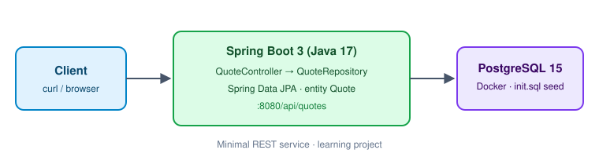

# QuoteVault API


Minimal REST service with Spring Boot, Spring Data JPA and PostgreSQL in Docker. It stores quotes and returns a random one. A small learning project for the basic Spring Boot stack: entity, repository, controller, database seeding.



## What it does

- Stores quotes (`author`, `content`) in PostgreSQL via Spring Data JPA
- Returns a random quote
- Seeds five sample quotes on first start (`initdb/init.sql`)
- Runs the database in Docker with a persistent volume

## API

| Method | Endpoint | Description |
|---|---|---|
| GET | `/api/quotes/random` | a random quote |
| POST | `/api/quotes` | add a quote |

```bash
curl http://localhost:8080/api/quotes/random

curl -X POST http://localhost:8080/api/quotes \
  -H "Content-Type: application/json" \
  -d '{"author":"Grace Hopper","content":"The most dangerous phrase is: we have always done it this way."}'
```

## Run locally

Requirements: Java 17, Docker.

```bash
git clone https://github.com/swittchen/quotevault-api.git
cd quotevault-api
docker compose up -d          # PostgreSQL on localhost:5432, seeded from initdb/init.sql
./mvnw spring-boot:run        # API on http://localhost:8080
```

Database name, user and password are set in `docker-compose.yml` and must match `application.yml`.

## Project structure

```
quotevault-api/
├── src/main/java/com/sergei/quotevault/
│   ├── QuotevaultApplication.java
│   ├── controller/QuoteController.java
│   ├── entity/Quote.java
│   └── repository/QuoteRepository.java
├── initdb/init.sql          # table + sample data
├── application.yml          # datasource and JPA settings
└── docker-compose.yml       # PostgreSQL 15
```

## Possible next steps

- [ ] `GET /api/quotes` (paged), `PUT` and `DELETE`
- [ ] Validation and a 404 when no quotes exist
- [ ] Integration tests with Testcontainers
- [ ] Containerise the API itself

## License

[MIT](LICENSE)
